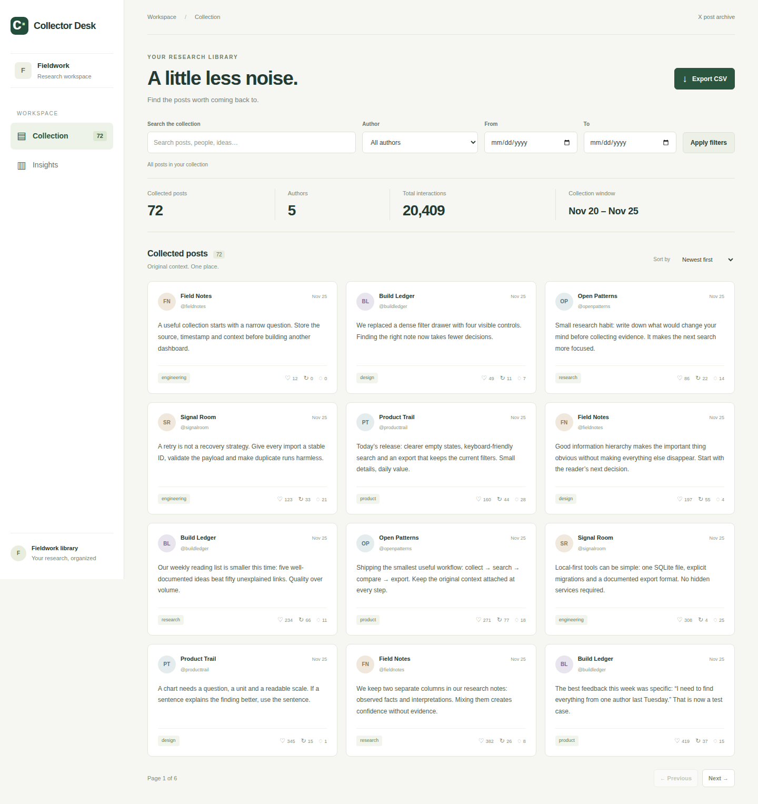

# Collector Desk

Search an archive of X-style posts, filter by author or date, and export the results as CSV. The demo uses React and TypeScript, with a Node.js API that reads from SQLite.



## What it does

- Browse a paginated post collection with author context and interaction counts
- Search text and people; combine exact-author and inclusive UTC-date filters
- Sort by publication date or total interactions
- Inspect daily collection counts and topic distribution
- Export the current filtered collection as spreadsheet-safe CSV
- Import your own normalized JSON locally, with validation and idempotent upserts
- Use the same workflow on desktop and narrow mobile screens

The demo includes 72 fictional posts from five fictional authors. It runs without an X account, cookies, API keys, or an external service. To use your own archive, import normalized JSON from an existing collector; Collector Desk does not fetch posts from X.

## Run

Requires **Node.js 24 or later** and npm. The app uses Node’s built-in SQLite module, which may print an experimental feature warning.

```sh
npm ci
npm run build
npm start
```

Open http://127.0.0.1:4318. The first start seeds a local database in data/; later starts preserve it.

Development with Vite hot reload:

```sh
npm run dev
```

Open the loopback Vite URL printed in the terminal. The API stays at `127.0.0.1:4318`.

## Your own collection

Start with a distinct empty database to avoid mixing real and synthetic rows:

```sh
DB_PATH=data/my-collection.sqlite npm run import -- posts.json
DEMO_SEED=false DB_PATH=data/my-collection.sqlite npm start
```

See [API and import format](docs/API.md). The app never fetches X, starts a collection job or handles account credentials. Keep private collections behind authentication if serving beyond loopback.

## Verification

```sh
npm test
npm run build
npx playwright install chromium
npm run test:ui
```

For an existing Chrome installation, set CHROME_PATH to its executable instead of downloading a browser. Only set CHROME_NO_SANDBOX=true in a disposable environment that requires it. Browser tests start a temporary loopback server with an in-memory database and close it afterward; screenshots are written to docs/.

[Insights screenshot](docs/insights-desktop.png) · [Mobile screenshot](docs/collection-mobile-390.png) · [Project map](PROJECT_MAP.md)

## Architecture

React → same-origin HTTP API → parameterized SQLite queries. Shared validated filters keep the feed, statistics and CSV consistent. Imports run as a separate local CLI with a single transaction. No runtime dependencies beyond React/ReactDOM; HTTP and SQLite use Node built-ins. Vite, TypeScript and Playwright are development tools.

The UI uses native forms, labels, keyboard submission, focus styles and responsive grid layouts. Browser checks ran in Chromium at 1440, 390, and 320 px. Safari on physical iOS devices and assistive technologies were not tested.

## License

MIT. See [LICENSE](LICENSE).

## Continuous integration

The reviewed workflow is provided at [ci/checks.yml](ci/checks.yml). It is a reference, not an active GitHub Actions workflow, until repository authorization permits publication under .github/workflows/. Local checks are independent of hosted CI.
